# Brutal Audience

> **Rehearse your audience before you meet them.**

*Generative AI · Creative Technology · Audience Simulation* — built for the Generative Clash hackathon, Storytelling and Co-Writers track.

Brutal Audience is a creative audience-simulation platform. A creator pastes a story, script, lyrics or essay; four AI reader personas read it **one segment at a time**, reacting as they go; the creator sees where attention rises, collapses or splits, and can test revisions and "what if" changes. **It never rewrites the work.** It does not create the art. It helps creators understand the people who experience it.

**Contents:** [Demo](#demo) · [Concept](#1-project-concept) · [Problem](#2-problem-statement) · [Solution](#3-proposed-solution) · [Features](#4-features) · [Architecture](#5-architecture) · [Tech stack](#6-technology-stack) · [Applications](#7-who-it-is-for) · [Responsible AI](#8-limitations-and-responsible-ai) · [Status and roadmap](#9-build-status-and-roadmap) · [Run it](#run-it) · [Deploy](#deploy)

---

## Demo

All media below was captured from the running app in **demo mode** using the sample story "The Dark Lighthouse". Demo mode makes the whole flow reproducible offline; with a key, the same screens show live model reactions.

[](docs/media/demo-walkthrough.mp4)

*Full walkthrough (about 40 seconds): landing → sign up → paste a draft → results dashboard → verdict → revision → what-if. [Watch the MP4](docs/media/demo-walkthrough.mp4).*

| | |
| --- | --- |
| **Landing page**<br>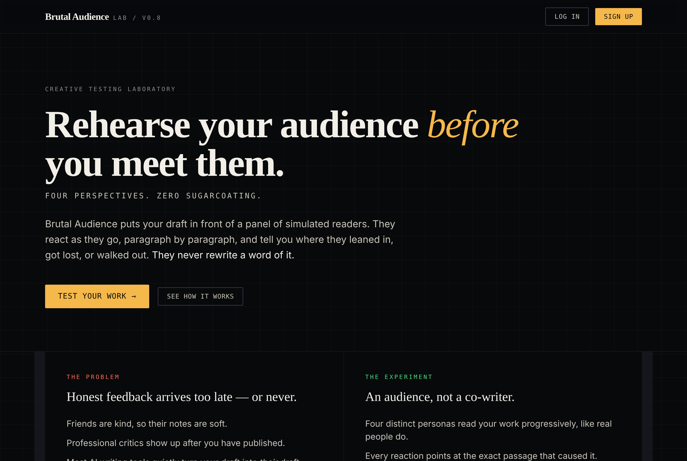 | **Workspace: paste a draft, inspect the segments**<br>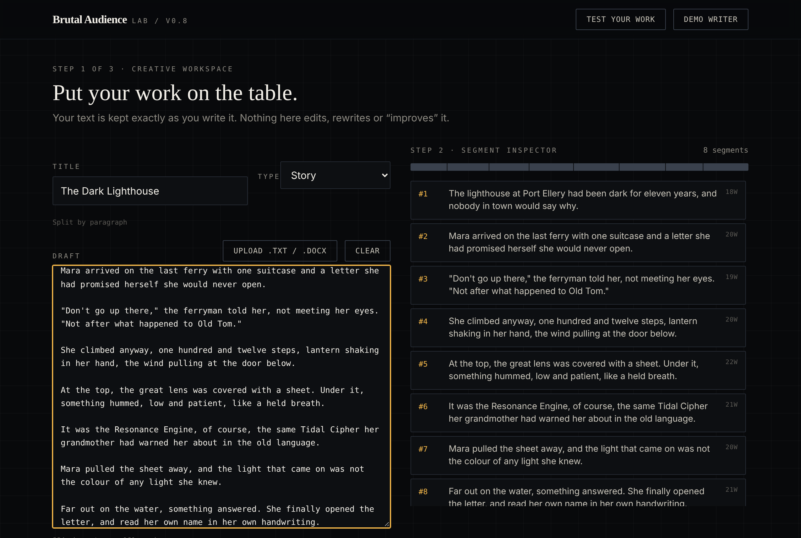 |
| **Results dashboard**<br>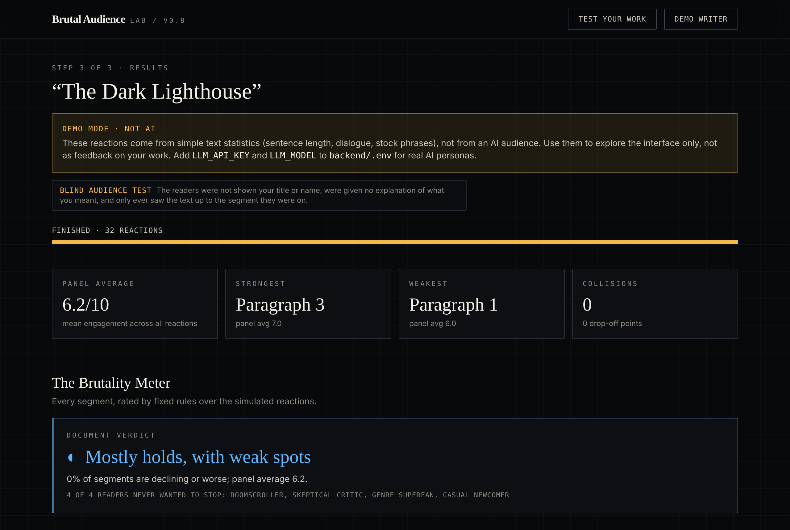 | **Brutality Meter**: fixed thresholds, no model<br>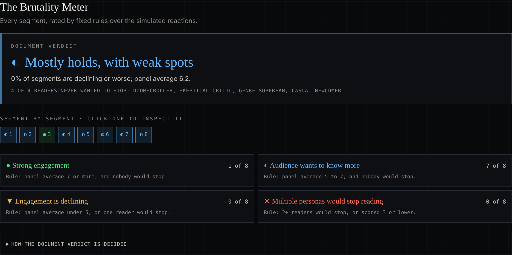 |

**Live Audience Theatre**: each persona's last reaction, plus a feed in the order reactions arrived (replayable).
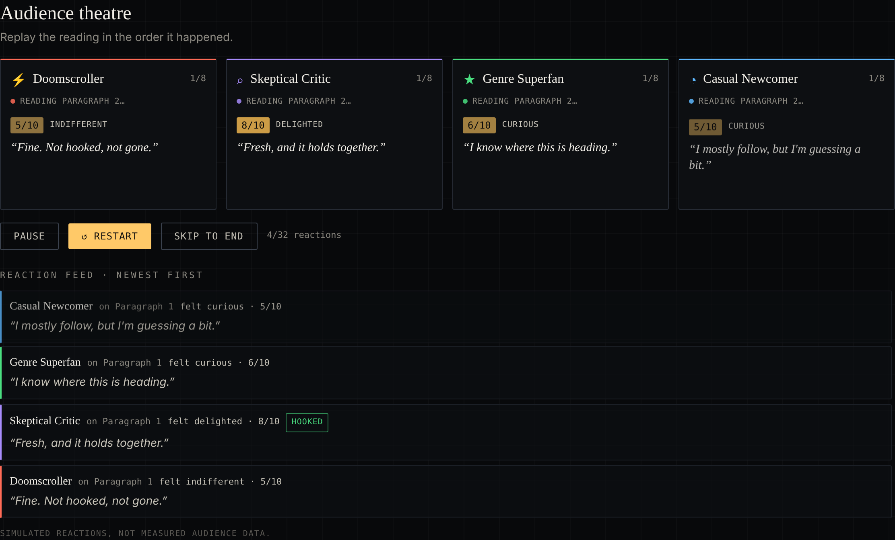

**Interactive heatmap and engagement chart**: personas × segments; click a cell for the reaction and the highlighted passage.
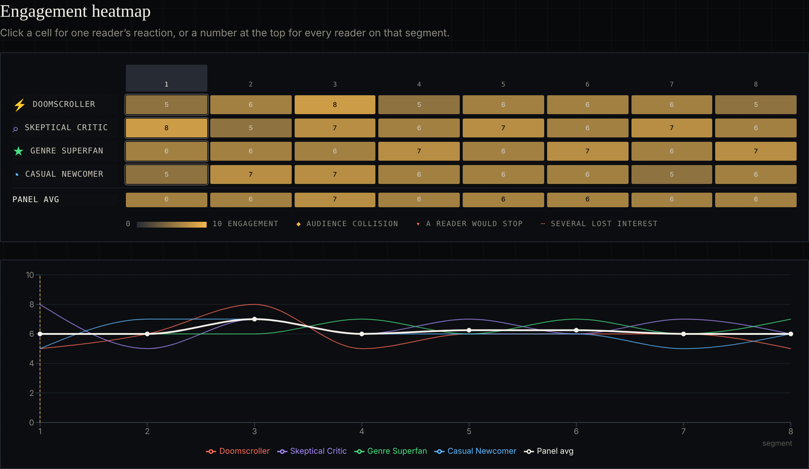

**Drop-off prediction**: retention curve and Continues / Drops off / Already left table. In demo mode nobody tends to stop, so the curve is flat here; the trigger-sentence path is covered by unit tests and shows when a reader would stop.
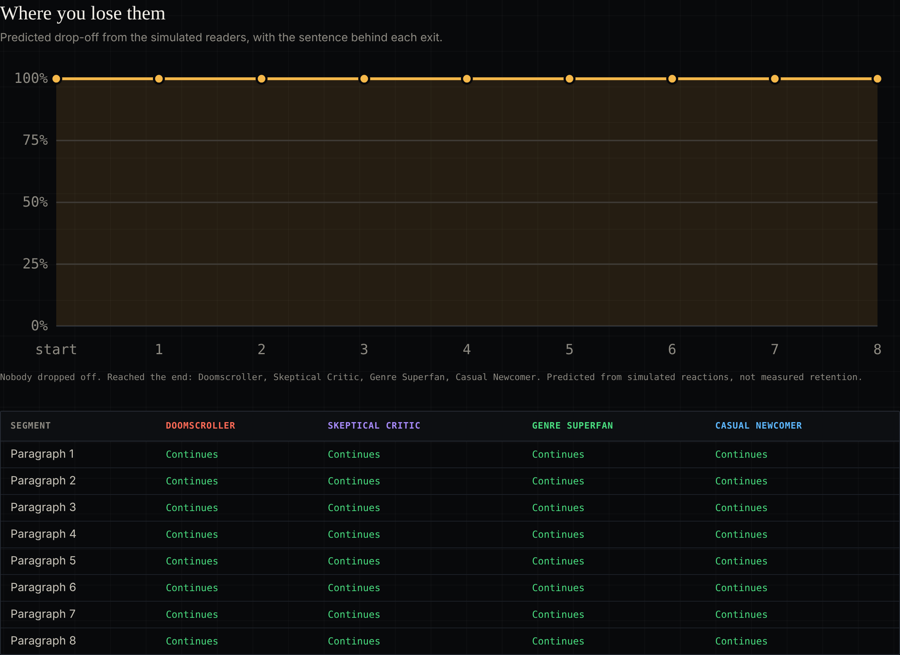

**Audience Split Detector**
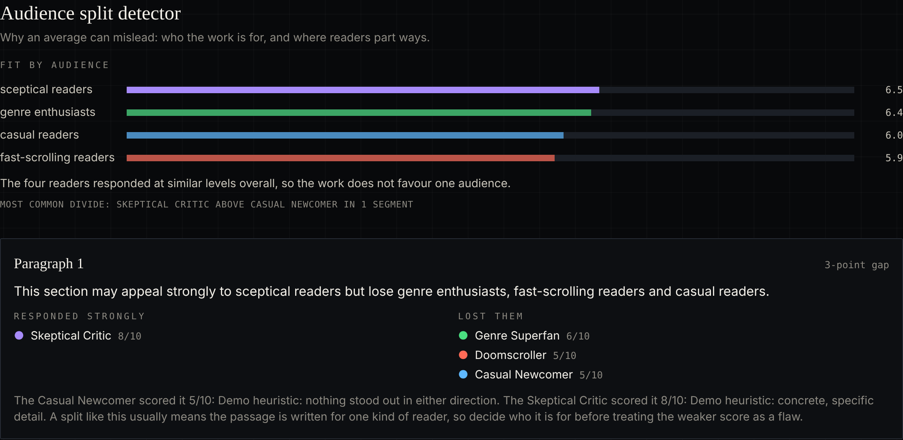

**Brutal Verdict**: strengths, weaknesses, per-persona takes, three evidence-linked suggestions (demo verdict is labelled as such).


**Revise and compare**: submit version 2 (or a "what if"), then see what changed.
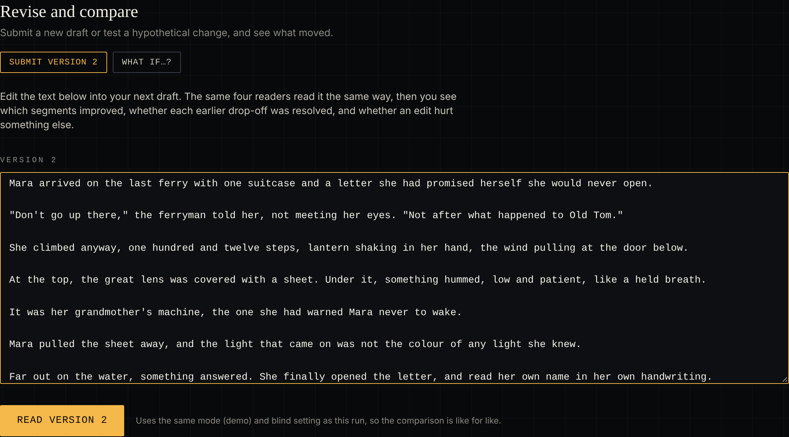
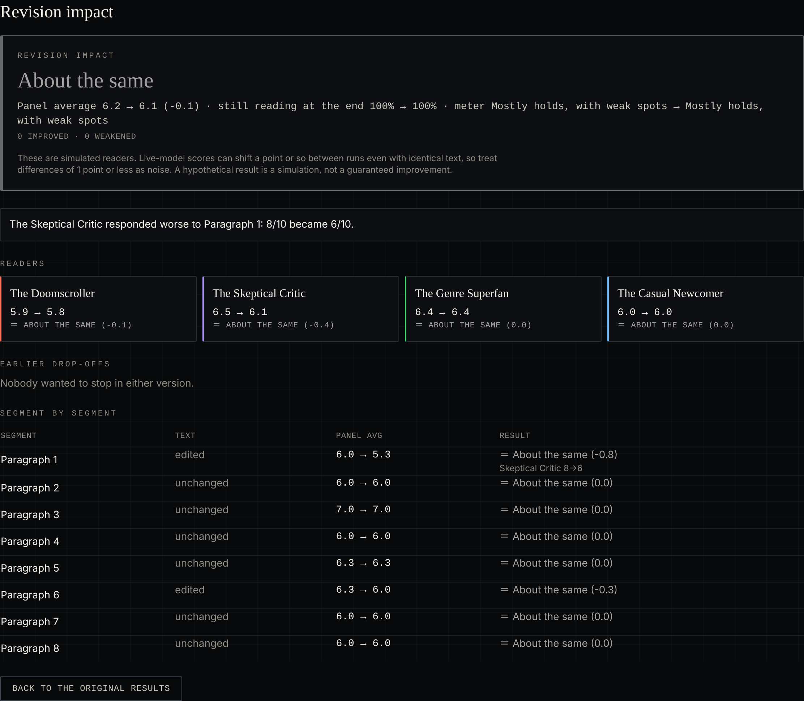
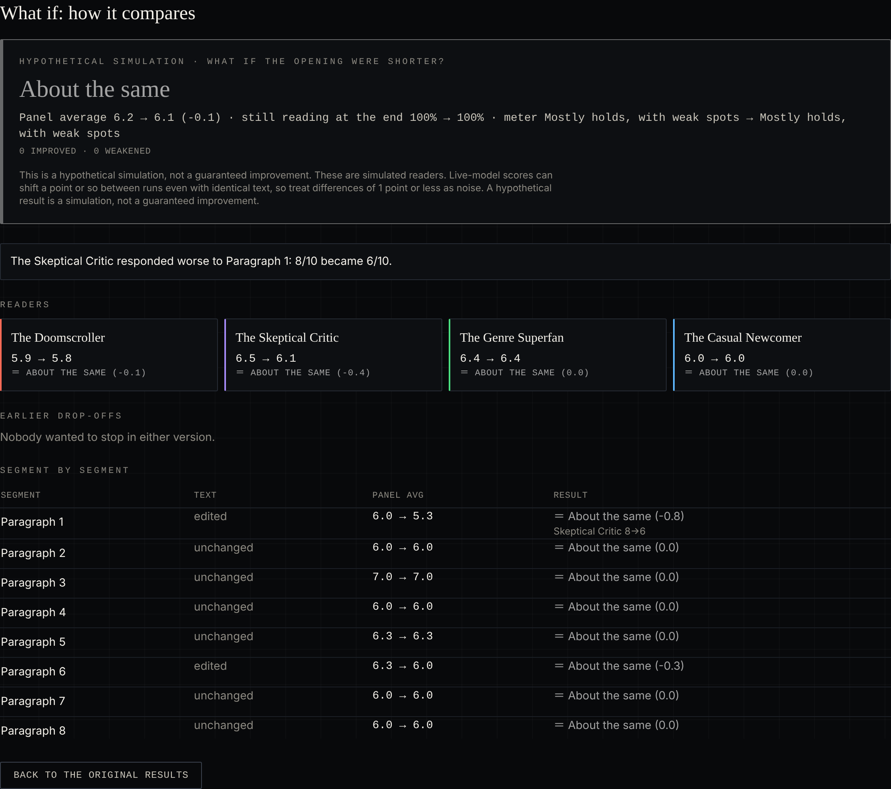

Re-create the captures: start the backend and frontend (see [Run it](#run-it)) and run a Playwright script against `http://localhost:5173`; the media lives in `docs/media/`.

---

## 1. Project concept

Most generative-AI writing tools generate, rewrite or "improve" content. Brutal Audience inverts that: the AI is the **audience**, not the co-author. Instead of one retrospective review of a finished document, each persona experiences the work the way a real reader does: progressively. It knows only what it has read so far, forms an impression, decides whether to keep going, and says why, pointing at the exact sentence responsible.

The result is a virtual audience-testing room where a creator can find strengths, weaknesses and communication barriers **before** the work reaches real people, while keeping complete creative control.

## 2. Problem statement

Creators struggle to get honest, diverse and timely feedback.

- Friends and acquaintances are kind, so their notes are soft or biased.
- Professional reviews and audience testing are slow and expensive.
- Problems with pacing, clarity and engagement are usually discovered only **after** publication.
- Different audiences read the same work differently, but conventional feedback is a single voice and rarely shows that spread.
- Existing AI writing tools generate or modify content; they do not analyse how different audiences *experience* it, and they quietly turn the creator's draft into the tool's draft.

**There is a need for structured, immediate, multi-perspective audience feedback that does not take creative control away from the creator.**

## 3. Proposed solution

A simulated audience panel powered by generative AI. Four specialised personas (each with its own system prompt, criteria and voice) read the work sequentially. For **every segment**, each persona returns a structured, validated reaction:

| Field | Meaning |
| --- | --- |
| Engagement (0–10) | How interesting the segment is to this persona |
| Emotion | curious, confused, bored, amused, surprised, moved… |
| Inner thought | One persona-specific line |
| Would continue? | Continuation intention |
| Evidence | A **verbatim** excerpt of the segment that caused the reaction (verified in code; unverifiable quotes are dropped, never shown) |
| Reason | Why it reacted this way |

The reactions are processed by **deterministic** analysis code (heatmap, Brutality Meter, collisions, retention curve, split detector, revision comparison) plus an LLM-written **Brutal Verdict** whose citations are validated against the text. Nothing is applied to the draft; all suggestions are recommendations.

The four personas:

| Persona | Characteristics |
| --- | --- |
| The Doomscroller | Short attention span; evaluates hooks, pacing and immediate engagement |
| The Skeptical Critic | Spots clichés, weak logic, inconsistencies, unrealistic developments |
| The Genre Superfan | Evaluates genre conventions, familiar tropes and expectations |
| The Casual Newcomer | Finds confusing references, unexplained concepts, accessibility problems |

## 4. Features

| Module | What it does | Status |
| --- | --- | --- |
| Upload and segmentation | Paste or upload .txt/.md/.docx; split into paragraphs / scenes / stanzas, each with an ID and its exact original text | ✅ |
| Persona engine | Four fixed personas with individual prompts, behind a provider-agnostic LLM interface | ✅ |
| Sequential simulation engine | Each persona reads in order, sees only what it has read, keeps its own history; schema-validated replies with retry | ✅ |
| Live Audience Theatre | Watch the four readers react as it happens, then replay it | ✅ |
| Interactive heatmap | Persona × segment grid; click a cell for score, emotion, thought, reason and the highlighted passage | ✅ |
| Brutality Meter | Per-segment and document verdict from published, fixed thresholds (no model involved) | ✅ |
| Drop-off prediction | Retention curve, Continue / Drops off / Already left table, the trigger sentence for each exit | ✅ |
| Audience Collision engine + Split Detector | Where readers disagree, who it appeals to, who is lost, and why, from the readers' own recorded reasons | ✅ |
| Blind Audience Test | Personas never receive the author, an explanation of the work, the title (by default) or any later segment | ✅ |
| Brutal Verdict | Overall response, strongest/weakest segments, per-persona likes and dislikes, three evidence-linked suggestions | ✅ |
| Revision Impact Tracker | Submit version 2; see improved/weakened segments, per-reader change, resolved drop-offs, side effects on untouched text | ✅ |
| What If? experiments | Hypothetical edit simulated without touching the draft, labelled "not a guaranteed improvement" | ✅ |
| Accounts and privacy | Register/login, private per-user data, delete account and all content | ✅ |
| Demo mode | Works with no API key (plain text statistics, **not AI**, and labelled as such everywhere) | ✅ |
| Custom personas from a target-audience description | Planned (see [roadmap](#9-build-status-and-roadmap)) | ⏳ |
| Cultural Context lens, Accessibility and Comprehension analysis | Planned | ⏳ |
| Style Guardian (compare with your earlier writing) | Planned | ⏳ |
| Debate mode, PDF export | Planned | ⏳ |
| Reality Check (predicted vs real reader feedback) | Long-term | ⏳ |

## 5. Architecture

A modular client–server system. The browser never talks to the LLM; the backend orchestrates the simulation, stores every reaction, and derives all numbers deterministically.

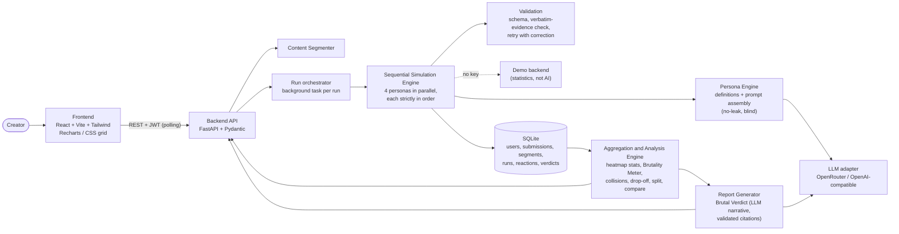

| Component | Responsibility | Code |
| --- | --- | --- |
| Frontend | Upload, segment preview, live theatre, dashboard, revision lab, auth | `frontend/src` |
| Backend API | Request handling, auth, ownership checks, run orchestration | `backend/app/routes`, `main.py`, `security.py` |
| Content Segmenter | Ordered segments whose text is exactly `content[start:end]` | `segmenter.py` |
| Persona Engine | Persona definitions and prompt assembly; **no future leakage**, blind mode | `personas/` |
| Sequential Simulation Engine | Parallel personas, strictly ordered reading, retries, cancellation | `simulation/` |
| LLM Integration | One small interface for OpenRouter and other OpenAI-compatible providers, with backoff on 429/5xx | `llm/` |
| Aggregation / Collision / Split / Drop-off / Meter / Compare | Pure, deterministic arithmetic over stored reactions | `analysis/` |
| Report Generator | Brutal Verdict: numbers computed in code, model writes only the narrative, every quote and segment ID validated | `analysis/verdict.py` |
| Database | Sessions, reactions and reports persisted; cascade delete on account removal | `db.py`, `run_store.py` |

**Design principles**

1. *The model never supplies numbers.* Scores come per reaction; every average, label, threshold, curve and comparison is code you can test (and the tests do).
2. *No fabricated evidence.* Quotes must be verbatim excerpts of the segment being read, or they are removed.
3. *No future leakage.* Tests inspect the real prompts to prove a persona never sees later segments, the segment count, or the author.
4. *Creator-centred.* No endpoint modifies a draft; revisions and what-ifs are stored as separate submissions.

## 6. Technology stack

| Layer | Technology |
| --- | --- |
| Frontend | React 18, TypeScript, Vite, React Router |
| UI styling | Tailwind CSS |
| Visualisation | Recharts and CSS grid (heatmap, retention curve, engagement chart) |
| Backend | Python, FastAPI |
| Data validation | Pydantic v2 (API models, LLM reply validation) |
| AI integration | Provider-agnostic adapter: OpenRouter, or any OpenAI-compatible endpoint (`LLM_PROVIDER`, `LLM_BASE_URL`, `LLM_MODEL`) |
| Auth | scrypt password hashing, signed JWT bearer tokens |
| Database | SQLite (WAL mode) |
| Testing | pytest (151 backend tests, no network or key needed) |
| Deployment | Vercel (frontend), Render (backend, `render.yaml`) |
| Version control | Git and GitHub |

## 7. Who it is for

Authors and writers (pacing, clarity, character), screenwriters and video-script writers, lyricists, educators (is the material comprehensible?), NGOs and public-awareness campaigns, advertising teams testing how audiences interpret copy, game writers, and multilingual creators.

## 8. Limitations and responsible AI

- Results are **simulated audience reactions and predicted drop-off points**, not measured audience retention or guaranteed predictions. Scores are subjective model estimates, not validated measurements. The UI says so wherever results appear.
- The platform never rewrites, edits or alters uploaded work. Recommendations only.
- Content is private to the account that created it and is never used for model training by this app. Users can delete a draft, or their whole account and all data, at any time.
- What-if results are labelled hypothetical, and small score changes between runs are flagged as noise.
- Planned cultural and accessibility analyses will be presented with uncertainty and will not replace testing with real people.
- More detail: [Honest limitations](#honest-limitations).

## 9. Build status and roadmap

This repository is the **pre-built portion**: the complete core loop (upload → sequential personas → reactions → analysis → verdict → revise and compare), accounts and deployment config. It is built in phases and each phase runs on its own.

| Phase | Scope | Status |
| --- | --- | --- |
| 1 | Scaffold, backend API, segmentation, SQLite, landing page, creative workspace | ✅ |
| 2 | Four personas, sequential simulation engine, validated JSON, LLM adapters, demo mode, live reading room | ✅ |
| 3 | Results dashboard, interactive heatmap, engagement chart, drop-offs, Audience Collision engine | ✅ |
| 4 | Brutal Verdict report, deployment config | ✅ |
| 5 | Register / log in, private per-user drafts and results, account deletion | ✅ |
| 6 | Live Audience Theatre, Brutality Meter, Blind Audience Test | ✅ |
| 7 | Drop-off prediction (retention curve + trigger sentence), Audience Split Detector | ✅ |
| 8 | Revision Impact Tracker, What If? experimentation | ✅ |

**Planned next (advanced version):** custom personas generated from a described target audience; Cultural Context lens; Accessibility and Comprehension analysis; Style Guardian; debate mode between personas; PDF report export. **Long term:** Reality Check (compare predictions with real reader feedback), multilingual support, audio/music and visual-storytelling analysis.

---


## Not built (out of scope for the MVP)

- Cultural and accessibility analysis, Style Guardian, custom personas, debate mode, PDF export and Reality Check: see the roadmap at the top of this file.

## Run it

**Prerequisites:** Python 3.10+, Node 18+.

### 1. Backend

```bash
cd backend
python -m venv .venv
source .venv/bin/activate        # Windows: .venv\Scripts\activate
pip install -r requirements.txt
cp .env.example .env
uvicorn app.main:app --reload --port 8000
```

With no key the app runs in **demo mode**. To use real AI personas with OpenRouter's free-model route, edit `backend/.env`:

```
LLM_PROVIDER=openai_compat
LLM_BASE_URL=https://openrouter.ai/api/v1
LLM_API_KEY=your-openrouter-key
LLM_MODEL=openrouter/free
```

`LLM_MODEL` has no default on purpose, because provider model IDs can change. Use `LLM_PROVIDER=openai_compat` plus an endpoint-specific `LLM_BASE_URL` for other OpenAI-style providers. Check `GET /api/health`: `mode_default` shows `live` once both key and model are set.

Tests (151, no network or key needed):

```bash
cd backend && pytest -q
```

### 2. Frontend

```bash
cd frontend
npm install
npm run dev
```

Open <http://localhost:5173>. In dev, Vite proxies `/api` to port 8000.

## API

| Method | Path | Purpose |
| --- | --- | --- |
| GET | `/api/health` | status, default mode, provider/model (never the key) |
| POST | `/api/segment` | stateless live segmentation preview |
| POST | `/api/upload` | extract text from .txt / .md / .docx |
| POST/GET/DELETE | `/api/submissions[/{id}]` | save / list / read / delete a work |
| POST | `/api/submissions/{id}/runs` | start a simulation `{mode: auto\|live\|demo, blind: true}` |
| GET | `/api/runs/{id}` | status, progress, segments and every reaction so far (poll this) |
| POST | `/api/auth/register`, `/api/auth/login` | create an account / log in, returns a bearer token |
| GET/DELETE | `/api/auth/me` | current user / delete the account and all its data |
| POST | `/api/runs/{id}/cancel` | stop a running simulation |
| GET | `/api/runs/{id}/analysis` | per-segment stats, drop-offs, collisions, agreements, Brutality Meter, drop-off prediction, split report (deterministic, safe mid-run) |
| POST | `/api/runs/{id}/revisions` | simulate version 2 of the draft `{content, title?}` (original run must be completed) |
| POST | `/api/runs/{id}/whatif` | simulate a hypothetical change `{hypothesis, content}` |
| GET | `/api/runs/{id}/children` | revisions and experiments made from a run |
| GET | `/api/runs/{id}/compare` | before/after comparison for a revision or what-if run |
| POST/GET | `/api/runs/{id}/verdict` | generate (or regenerate) / fetch the Brutal Verdict; the run must be finished |

Interactive docs at <http://127.0.0.1:8000/docs>.

## Project layout

```
backend/app/
├── main.py  config.py  db.py  run_store.py  schemas.py
├── segmenter.py  file_parser.py
├── personas/        definitions.py (the 4 personas)  prompts.py (prompt assembly)
├── llm/             base.py  provider adapters  factory.py
├── simulation/      engine.py  backends.py (live + demo)  validation.py  types.py
├── analysis/        stats.py (collisions, drop-offs)  meter.py  dropoff.py  split.py  compare.py  verdict.py  models.py
└── routes/          content.py  runs.py  analysis.py
backend/tests/       segmenter, API, validation, engine (incl. no-leak), adapters (mocked HTTP), analysis, verdict
frontend/src/
├── pages/           Landing  Workspace  RunPage
├── components/      SimulationPreview  SegmentInspector  PersonaLanes  ReactionDetail  ModeBanner
│                    Dashboard  Heatmap  EngagementChart  SegmentCompare  CollisionPanel  VerdictPanel
│                    AudienceTheatre  BrutalityMeter  BlindBadge  RetentionCurve  SplitDetector
└── lib/             api.ts  useRun.ts  heat.ts  personas.ts  theatre.ts  meter.ts
```

## Deploy

- **Backend → Render.** Create a Blueprint from this repo (`render.yaml`; it generates `JWT_SECRET` for you). Set `LLM_API_KEY`, `LLM_MODEL` and `CORS_ORIGINS` (your Vercel URL) in the Render dashboard.
- **Frontend → Vercel.** Root directory `frontend`; set `VITE_API_URL` to the Render URL (no trailing slash). `frontend/vercel.json` handles client-side routes.

## Honest limitations

- Simulated personas are an informed guess, not real readers; scores are subjective estimates.
- The provider adapters are tested against a mocked HTTP server (request shape, retries, errors), not against live APIs, since those need your key. The first real run is the real test.
- Concurrency is per run (4 personas at once). There is no global rate limiter, so heavy parallel use on a free API tier may hit 429s (they are retried with backoff).
- Render's free disk is ephemeral, so SQLite data resets on redeploy.
- Long works only keep the most recent ~6,000 characters of already-read text in each prompt. Earlier segments are carried through the persona's own reactions.
- Collision and drop-off thresholds (4-point gap, 3-point split, 3-or-lower for "lost interest") are sensible defaults, not validated measures. They are constants at the top of `analysis/stats.py`.
- The live Brutal Verdict has only been tested against a fake model client, like the adapters. The first real run is the real test.
- The browser flow (workspace → run → dashboard → verdict) was exercised end to end in demo mode only.
- Render's free tier has an ephemeral disk, so the SQLite file (accounts included) is wiped on redeploy. Use a persistent disk or a hosted database before real users.
- The Brutality Meter thresholds (7 / 5 / 2 readers, and the document-level shares) are sensible defaults, not validated measures. They are constants at the top of `analysis/meter.py`.
- The Blind Audience Test hides the title and guarantees what the prompts contain; it cannot stop the work's own text from giving away its ending to a reader who has reached it. Personas are simulated, so "blind" describes what they are given, not a controlled experiment.
- The Phase 6 interface was type-checked and built, and the API was exercised end to end in demo mode, but the theatre and meter have not been checked by eye in a browser.
- The Phase 7 interface was type-checked and built, and the API exercised end to end in demo mode, but not checked by eye in a browser. The trigger-sentence path is covered by unit tests; the demo heuristic rarely makes a reader stop.
